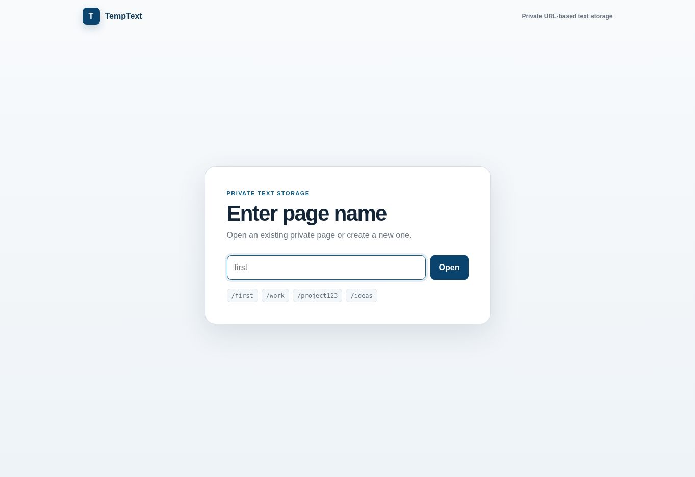

<div align="center">

# TempText

**A simple, password-protected place for text at your own URL.**

[Live site](https://temptext.dripsent.me/) · [Installation](#installation) · [Project layout](#project-layout)

</div>



TempText is a small PHP and MySQL application. Choose a page name, protect the page with a password, and organize its text across tabs. The interface includes saving, renaming, locking, clearing, and a last-saved indicator. Page content is stored in MySQL; the site uses sessions and CSRF tokens for editing actions.

> [!IMPORTANT]
> This is password-protected text storage, not end-to-end encryption. The server and database can access stored content. Avoid using it for credentials or other highly sensitive information.

## Requirements

- PHP 8.1 or newer with `pdo_mysql`
- MySQL or MariaDB
- Apache with `mod_rewrite` and `.htaccess` support
- A database user with permission to create tables on first run, or pre-created tables from `database.sql`

## Installation

1. Upload `index.php`, `db.php`, `.htaccess`, and `config.php.example` directly into the domain's document root. No extra `public` directory is needed. The styles and scripts are included in `index.php`.
2. Copy `config.php.example` to `config.php` in the same directory and enter your own database credentials. **Never commit `config.php`**; `.gitignore` excludes it.
3. The app creates the `pages` and `page_tabs` tables when it first connects. If the database user cannot create tables, import `database.sql` once through your database administration tool.
4. Open the domain and choose a page name. An existing page requires its password; a new page asks you to create one.

If you deploy by cloning this repository into an existing site folder, keep its existing `config.php` in place. Do not overwrite live credentials. The ZIP's server-specific PHP handler was omitted from `.htaccess`; configure the PHP version through your host's control panel if required.

## Project layout

| Path | Purpose |
| --- | --- |
| `index.php` | Routes, page and tab actions, UI, embedded CSS and JavaScript |
| `db.php` | PDO connection and automatic table creation |
| `database.sql` | Optional manual schema import |
| `config.php.example` | Safe configuration template |
| `.htaccess` | Routing and access restrictions |
| `docs/screenshot.jpg` | Screenshot of the live homepage |

The archive also contained a duplicate `f.zip` and host-managed `.well-known` and `cgi-bin` directories. They are excluded from the source repository.

## Local checks

```bash
php -l index.php
php -l db.php
php -l config.php.example
```

## License

No license has been granted yet. Contact the repository owner before reusing or distributing the code.
